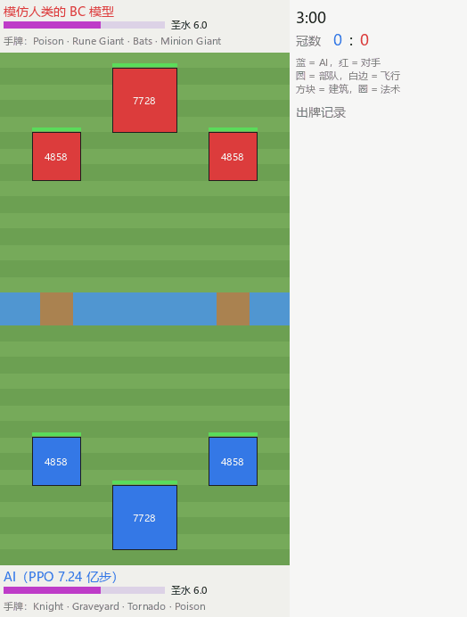
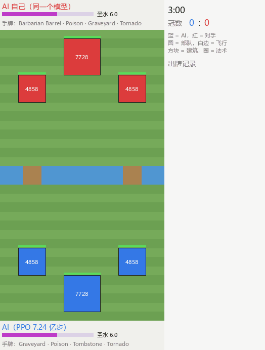

# cr-rl：自己学会打皇室战争的 AI

这个 AI 先看真人高手的对局学个大概，再靠对打练了 7 亿多步。这里公开它的训练代码、训练记录和模型权重。

<p align="center"></p>
<p align="center">蓝方是 AI，红方是模仿人类高手的模型。这一局 2 分 30 秒打成 3:0。画面 5 倍速。</p>

| | |
|---|---|
| **它是什么** | 一个神经网络。每 0.25 秒看一次战场，决定出不出牌、出哪张、放在哪，以及什么时候发动英雄/冠军技能 |
| **有多强** | 对「模仿人类高手的模型」100 局赢 92–98 局；对 2.48 亿步时的自己赢约 58% |
| **怎么练出来的** | 先模仿约 25 万局真人对局，再和自己、和自己的旧版本对打。一张 RTX 4090，前后约两周 |
| **这里有什么** | 训练代码、全部配置、训练机上实际用的参数和每次改动的记录、两个模型权重 |
| **这里没有什么** | 游戏引擎和游戏数据，所以**下载后不能直接玩** |

按你想做的事选一条路：

- **[我只想看看](#我只想看看)**：看 AI 打几局，用大白话了解它是怎么练出来的、中间踩过哪些坑。
- **[我想研究](#我想研究)**：模型结构、训练流程、怎么加载权重、怎么把模型接到自己的环境里。

本项目和 Supercell 没有关系；“皇室战争 / Clash Royale”是 Supercell 的商标。

---

## 我只想看看

### 看 AI 打一局

最上面那段是 AI 对「模仿人类高手的模型」。下面这段是同一个 AI 自己打自己，双方都用龙骑墓卡组：常规 3 分钟打平，进加时后蓝方先推掉一座塔获胜。

<p align="center"></p>

怎么看这两张图：

- 下半场蓝色是 AI，上半场红色是对手。圆点是部队（带白边的会飞），小方块是建筑，空心圈是法术。
- 大方块是塔，数字是剩余血量。推掉一座公主塔得 1 冠，推掉国王塔直接拿 3 冠获胜。
- 上下两条是双方的圣水和手牌，右边是出牌记录（时间是比赛剩余时间，牌名用英文）。

AI 用的卡组叫「龙骑墓」：墓园、进化小皮龙、进化骑士、英雄墓碑、冰法、毒药、龙卷风、野蛮人滚桶。

### 它是怎么练出来的

**第一步：看人怎么打。** 把约 25 万局真人高端对局（大多是排位赛）放进引擎一帧帧重放，让模型去猜“这一刻人会出哪张牌、放在哪”。练完后，它能猜中人类下一张牌约 65%，落点误差在一格以内的约 60%。这时它打得像个普通高手，但人的坏习惯也一起学了。这一步叫模仿学习。

**第二步：和固定的陪练对打。** 拿第一步的模型当陪练，让 AI 跟它打，赢了加分、输了扣分，AI 自己摸索怎么赢。这一步叫强化学习。练了 5,000 万步，对陪练的胜率从 45% 涨到 89%。

**第三步：和自己对打。** 对手 80% 是现在的自己，20% 是自己过去的存档，越打不过的旧版本越常被抽到；对手的卡组从 505 套主流卡组里抽。这样 AI 不会只会对付一种打法，也不容易忘掉以前学会的东西。这一步练了 6 亿多步，现在还在练。

**第四步：中途把模型变大。** 练到 6.8 亿步时想让模型更大，又不想从头练。办法是把网络加宽（1,467 万 → 3,538 万个参数），新加的部分一开始不起作用，所以扩完的模型和原来打法一模一样，然后接着练。

### 路上踩过的坑

- **调高学习率反而变差。** 2.6 亿步时想让它学快点，把学习率调高了 6 倍，结果之后一亿步都没进步。后来从同一个起点做了对照实验才确认：调回原来的小学习率明显更好。
- **进步越来越难看出来。** 打 100 局算出的胜率，误差有 ±10 个百分点，比一段训练里真正的进步还大。后来改成固定几个“考官”存档，每次打 400 局，而且同一对卡组双方换边各打一局，抵消卡组运气。
- **平台期。** 大约 3.8–4.3 亿步以后提升很慢。我们让新模型和自己各个时期的存档对打，确认它对所有旧版本都不输，说明不是练坏了，而是涨不动了。
- **AI 几乎不用英雄技能。** 人类玩家里，手上有英雄牌的有 50–80% 会在一局里用技能；AI 每一步按技能的概率只有万分之一到万分之八。排查发现它根本看不到一些关键信息：对手放的狂暴法术、进化牌还差几次才进化、自己是不是已经按过技能、单位身上有没有被减速冰冻。补上这些之后它还是不用；又试了“逼它多尝试技能”，训练变得不稳定，两小时后被自动止损撤回。这个问题还没解决。
- **一个藏得很深的 bug。** 和旧存档对打时，对手会在一局中途被换成另一个旧存档，胜负却记在开局那个存档上，“哪个旧版本难打”的统计因此全乱了。
- **人为失误。** 有一次配置写错，用错的卡组练了 5,000 万步才发现。
- **高端局本来就“闷”。** 统计真人高端对局，85% 会打进加时，大多 1:0 结束。AI 的对局也一样（86–89% 进加时）。这不是 AI 打得保守，高水平对局本来就是这样。

### 常见问题

- **能下载下来玩吗？** 不能。AI 要在游戏引擎里才能打，引擎没有公开。
- **它比真人强吗？** 这里只报告模拟器里的结果：它稳定打赢模仿人类高手的模型，但这个模型猜中人类出牌的准确率约 65%，并不等于真人高手，所以不能据此说它比人强。
- **只会用一套卡组吗？** 训练时 30% 的对局用龙骑墓，其余用随机卡组，所以别的卡组它也会打：双方都随机抽卡组时，对模仿人类的模型胜率 92–94%。
- **画面里的数字从哪来？** 录像是用公开的权重在引擎里实际打出来的，画面由我们自己的脚本绘制，不是游戏截图。

---

## 我想研究

### 权重（见 Releases）

| 文件 | 内容 |
|---|---|
| `ppo_step724051358.pt` | 主模型，PPO 训到 7.24 亿步（2026-10-31），3,538 万参数，fp32 |
| `bc_v2_ft3.pt` | 行为克隆模型（PPO 的起点和 KL 参考），扩容前的结构，1,467 万参数 |

存档是普通 dict，`torch.load(..., weights_only=True)` 就能读：`model`（state_dict）、`cfg`（训练时的完整配置，建网用它就够了）、`step`、`kind`。

```python
import torch
from cr_ai.config import _wrap
from cr_ai.model.net import Net, load_weights

st = torch.load('ppo_step724051358.pt', map_location='cpu', weights_only=True)
net = Net(_wrap(st['cfg'])).eval()        # _wrap：dict → 支持属性访问的配置
load_weights(net, st['model'])
# out, state = net(obs, state)   # obs 的字段见 cr_ai/env/game_env.py: obs_spec
```

BC 存档是扩容前的结构，装进新结构要用 `load_weights(net, sd, grow=True)`（自动补成新结构，函数不变）。

### 模型

- 输入：32×18 网格（单位/法术嵌入 + 数值通道）、单位列表（最多 128 个，带减速/冰冻等状态）、标量（圣水、时间、塔血、国王塔是否激活……）、
  手牌 5 张（含进化充能）、自己的卡组、对手出过的牌、英雄/冠军技能状态。只用对局里玩家看得到的信息（对手手牌和圣水只用估计）。
  另有一个只给价值头用的特权分支（训练时用对手的真实信息，推理时不用）。
- 主干：卷积残差网络 + 单位列表的 Transformer 分支 → 融合层 → LSTM（1536）。
- 输出：牌头（不出 / 手牌 4 张 / 技能 2 个）、位置头（576 格，以选中的牌为条件）、价值头。
- 细节见 `cr_ai/model/net.py` 开头的说明。

### 训练流程

1. **回放 → BC 数据**：`cr_ai/data/replay_parser.py` 解析回放，`cr_ai/data/replay_resim.py` 在引擎里逐 tick 重放并采样（双方视角都采），
   `cr_ai/tools/reshard_bc.py` 把分片打散。
2. **行为克隆**：`python -m cr_ai.train.bc --config cr_ai/configs/bc.yaml cr_ai/configs/arch_v2.yaml --run runs/bc_v2`，
   再用新版本回放微调（`cr_ai/configs/bc_ft_scrape.yaml`）。
3. **PPO**：`cr_ai/train/ppo.py`（学习进程）+ `cr_ai/train/rollout.py`（采样进程，推理走 CUDA Graph，见 `cr_ai/model/infer.py`）。
   循环 PPO、GAE、对 BC 的 KL 约束、价值头带胜率先验。
4. **联赛**：`cr_ai/tools/league_loop.py` 分段训练主模型，每段结束后在后台对固定考官评测。对手 80% 是当前策略自己、20% 是历史快照
   （PFSP：越打不过的快照越常被选）。卡组从卡组池（`cr_ai/configs/deck_pool_mix.yaml`，505 套）按 PFSP 抽，30% 的对局用主卡组。
   `league_loop` 也支持剥削者（专门找主模型漏洞的模型），2026-10-21 起关掉了（`--no-exploit`）。
5. **扩容**：`cr_ai/tools/grow.py` 在训练中途把网络加宽（LSTM 768 → 1536 等），扩容后和原网络是同一个函数，接着训。
6. **评测**：`cr_ai/eval/arena.py`（对打）、`cr_ai/tools/gauntlet.py`（对固定考官打，Bradley–Terry 拟合 Elo）。
7. **看板**：`python -m cr_ai.tools.dashboard`（读 `runs/<run>/` 下的日志）。

`scripts/` 里是训练机上实际用的启动命令和覆盖参数：
- `scripts/m4_common.txt`：主模型和剥削者共用的覆盖（模型尺寸、卡组池、BC 存档……）；
- `scripts/m4_main.txt`：只给主模型的覆盖，每一行改动的原因和止损条件都写在注释里，是这个模型训练过程的记录；
- `scripts/v2_m4h.sh`：`league_loop` 的启动命令。

配置按顺序叠加：`cr_ai/configs/default.yaml` ← `ppo.yaml` ← `m4.yaml` ← `arch_v2.yaml` ← 覆盖文件（每行一个 `a.b=值`）。

### 如何应用这个模型

模型每 0.25 秒（引擎 5 个 tick）走一步：

- **输入**：一个观测字典。字段和形状见 `cr_ai/env/game_env.py` 的 `obs_spec`，怎么从对局状态算出来见 `cr_ai/env/features.py`、`rasterize.py`。
  要接到自己的环境，就要能从你的环境里读出这些信息（单位位置和血量、圣水、手牌、塔血、时间等）。
- **输出**：`sel`（0 = 不出，1–4 = 打出第几张手牌，5–6 = 发动第几个技能）和 `cell`（落点，18 列 × 32 行，以自己这边为下方，`cell = 行 × 18 + 列`）；
  另有价值头给出当前局面的胜负估计（−1 到 1）。
- **有记忆**：LSTM 状态要一步一步传下去，每局开始时清零。
- **延迟**：出牌约 1 秒后才生效（游戏规则），训练时就是这样，不用另外补偿。

最省事的调用方式是评测脚本里的 `Policy`（批量推理，走 CUDA Graph；在 RTX 3070 上单局一步约 5 ms）：

```python
from cr_ai.eval.arena import Policy

pol = Policy('ppo_step724051358.pt', stateful=True, temperature=1.0)
acts = pol.act(obs_batch, keys=['game1'])    # obs_batch：每个字段前面加一个 batch 维；返回 [N, 2] = (sel, cell)
pol.reset('game1')                           # 一局结束时清掉这局的记忆

sel, cell = acts[0]
row, col = divmod(int(cell), 18)             # 自己视角的行列；在上半场的一方要把行翻转（31 - row）
x, y = col * 1000 + 500, row * 1000 + 500    # 引擎坐标：1 格 = 1000
```

`temperature` 是 1.0 时按训练时的分布抽动作（评测都用 1.0）；调低（比如 0.6）会更常选它认为最好的那一手。

可以拿它做的事：

- **对手或陪练**：放进自己的对战模拟器当对手，用 `temperature` 调难度；Release 里的 BC 模型是一个更像人、也更弱的对手。
- **局面评估和复盘**：价值头是模型对当前局面胜负的判断。把一局的价值画成曲线，掉得最多的地方往往就是关键失误。
- **出牌建议**：看牌头的概率分布和位置头的热力图，列出模型认为最好的几种出法。
- **卡组强弱测试**：让同一个 AI 拿不同卡组互打，比较胜率。训练里按卡组选对手的统计就覆盖了 495 套卡组。
- **强化学习研究**：多智能体、不完全信息、实时决策的基线。

### 目录

| 路径 | 内容 |
|---|---|
| `cr_ai/env/` | 观测（`features.py`、`rasterize.py`）、动作掩码（`masks.py`）、奖励、对手牌追踪、多进程环境（`vec_env.py`）、引擎适配层 |
| `cr_ai/model/` | 网络（`net.py`）、CUDA Graph 推理（`infer.py`）、扩容（`grow.py`） |
| `cr_ai/train/` | BC、序列 BC、PPO、采样、联赛、蒸馏 |
| `cr_ai/data/` | 回放解析、重模拟、BC 数据加载 |
| `cr_ai/eval/`、`cr_ai/tools/` | 评测、考官、联赛循环、扩容工具、看板、卡组池生成 |
| `cr_ai/configs/` | 全部配置和卡组池 |
| `cr_ai/assets/` | 单位/卡牌词表、每张牌的合法落点表 |
| `cr_ai/tests/` | 单元测试（大部分要引擎才能跑） |
| `scripts/` | 训练机上的启动脚本和覆盖参数 |
| `docs/` | README 里的对战录像 |

环境层通过 `cr_ai/env/engine_adapter.py` 调引擎（`from crx.engine import Engine`）。引擎没有公开，要跑训练需要自己提供一个接口相同的引擎；
只加载权重、做推理不需要引擎。

### 依赖

Python 3.10+、PyTorch 2.x（CUDA）、`requirements.txt` / `requirements-linux.txt`。

## 许可证

代码和 Releases 里的权重都按 MIT 许可证发布（见 `LICENSE`）。
